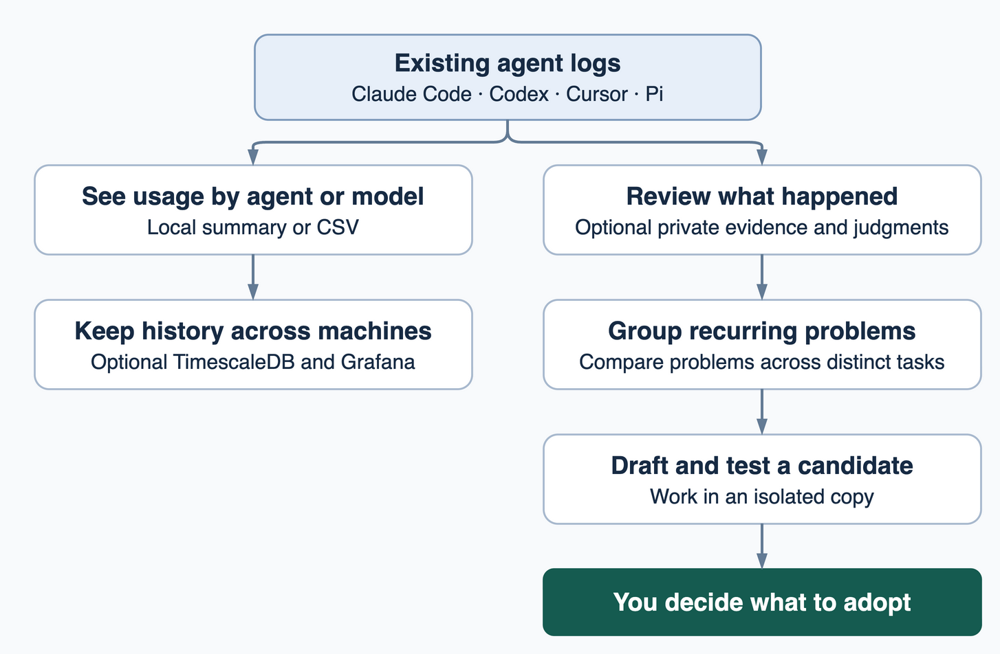
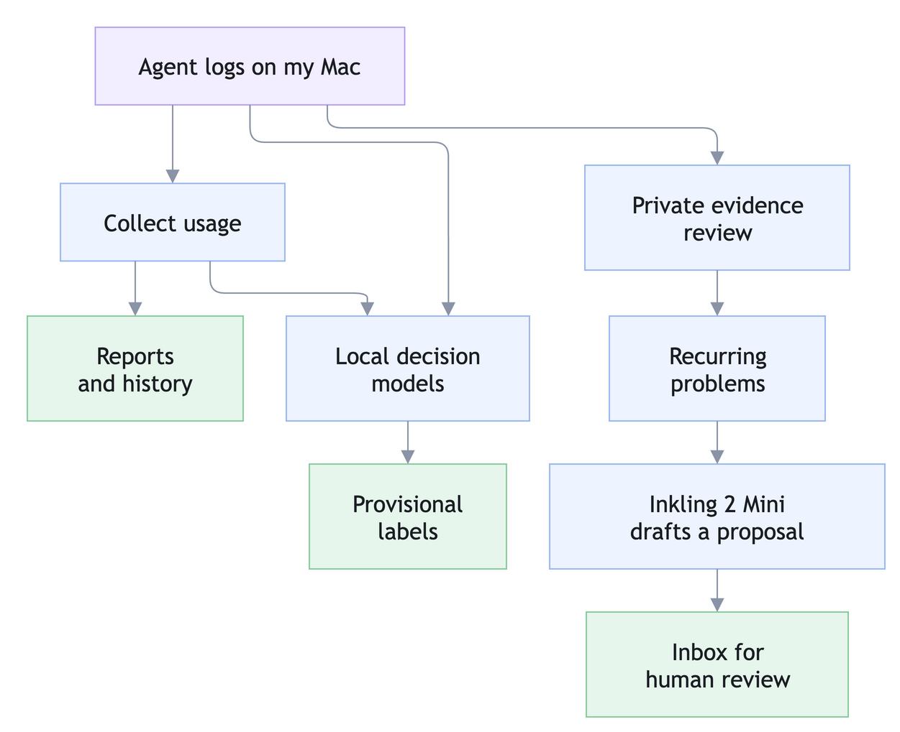

# Agent Usage Tracker (`aut`)

[](https://github.com/rhnfzl/agent-usage-tracker/actions/workflows/ci.yml)
[](https://pypi.org/project/agent-usage-tracker/)
[](https://github.com/rhnfzl/agent-usage-tracker/blob/main/LICENSE)

**See where your coding agents spend tokens, how the work ends, and what keeps going wrong.**

AUT reads the logs Claude Code, Codex, Cursor, and Pi already save. Start with a local usage report or CSV. Add your own database for session history across machines. The optional improvement workflow links recurring problems to the evidence and drafts changes you can review.

## Quick start

With [uv](https://docs.astral.sh/uv/getting-started/installation/) installed, try the demo with synthetic logs:

```sh
uvx agent-usage-tracker demo
```

The demo finds two agent records totaling **1,140 tokens**. It shows input, output and cache separately, and reports missing model prices as unknown. Try the same report with your own logs, or export them as a CSV:

```sh
uvx agent-usage-tracker summary --period week --group-by agent
uvx agent-usage-tracker --agents claude_code,codex,cursor_cli,pi export --out usage.csv
```

Local reporting runs without a database, a provider account, or a model. The CLI runs on macOS, Linux, and Windows with Python 3.11 to 3.15. See [first run](https://github.com/rhnfzl/agent-usage-tracker/blob/main/docs/first-run.md) for installation, source checks, and the private browser overview.

## What you can track

| Question | Where to start |
|---|---|
| Which agents and models am I using? How much is cached? | Local summary and CSV export. |
| Which sessions belong to the same work? What happened to their commits? | Your own TimescaleDB and Grafana stack, with Git outcome tracking. |
| How much of my work is building, debugging, planning, or review? | Optional local models estimate work categories and leave uncertain cases unknown. |
| What if I lose this laptop? | Optional encrypted backups of agent logs and AUT settings with restic. |

## From a repeated problem to a fix you can review



For example, an agent says the tests passed. AUT can surface the tool result behind that claim. If the result is missing, the judgment can stay unknown. When judgments identify the same problem across distinct tasks, AUT can group those cases and draft a small instruction or config change in an isolated copy. Run a check you trust against the original and the candidate, then decide whether to adopt it.

Start by freezing a small sample of recent sessions. This step runs locally without a model:

```sh
uvx agent-usage-tracker improve audit --days 7 --limit 30
```

The [improvement guide](https://github.com/rhnfzl/agent-usage-tracker/blob/main/docs/improvement.md) covers private evidence, advisory judgments, drafts, and the review inbox. The [study guide](https://github.com/rhnfzl/agent-usage-tracker/blob/main/docs/improvement-studies.md) explains how to test a candidate. Source edits require an explicit decision. A passing check supports the tested change; measuring an improvement in real work requires comparable follow-up.

You can also ask a coding agent to explore that evidence directly. Run `aut evidence capture` for a private full-text audit, then search and compare runs through the CLI or MCP. Choose what the client can read and link useful findings to a repair you can test. See the [agent evidence guide](docs/evidence.md).

## How I run AUT

I run AUT on an Apple silicon Mac to track agent usage, classify work, and find recurring problems. AUT sends usage metadata to a self-hosted database. The local labeler combines that metadata with request and reply text on the Mac.



| Job | Models I use | Method |
| --- | --- | --- |
| What my message is doing | Elephant 1, PPLX Decider Flash, Kev 4B | Weighted scores |
| What kind of work I’m doing | PPLX Decider Flash, Elephant 1, Clef Flash | Majority vote |
| Where work with no code changes stands | Elephant 1, Kev 4B, Clef Flash | Weighted scores |
| Draft a fix for a recurring problem | Inkling 2 Mini via llama.cpp | Low reasoning effort, then human review |

The label recipes leave uncertain cases unknown. I run the larger Inkling model only when a recurring problem is eligible for a draft. Each proposal goes to a private inbox for review.

You can adapt this setup by starting with one [local decision model](https://github.com/rhnfzl/agent-usage-tracker/blob/main/docs/local-labels.md#ongoing-local-estimates) per job and checking it against examples you’ve reviewed. Add [offline drafting](https://github.com/rhnfzl/agent-usage-tracker/blob/main/docs/improvement.md#drafted-proposals) when you have a recurring problem worth testing a fix for.

## Collectors

Claude Code, Codex, and Pi supply native token records. Cursor CLI supplies prompts and activity. For Cursor token totals, choose one of the IDE, API, or SDK sources to avoid double-counting. T3 Code activity and ActivityWatch are optional. See the [collector matrix](https://github.com/rhnfzl/agent-usage-tracker/blob/main/docs/reference.md#collectors) and [coverage guide](https://github.com/rhnfzl/agent-usage-tracker/blob/main/docs/harness-coverage.md).

## Privacy model

Normal collection works from existing logs. If you configure a sink, it receives usage and activity metadata such as counts, project basenames, and commit IDs. Prompt text and tool output stay off that path. Optional remote drafting sends selected file text and review summaries after redaction. Remote drafting requires a separate opt-in for conversation excerpts. Evidence access uses the content mode you choose for that connection or export. See the [privacy and network-call reference](https://github.com/rhnfzl/agent-usage-tracker/blob/main/docs/reference.md#privacy-model) and [drafting guide](https://github.com/rhnfzl/agent-usage-tracker/blob/main/docs/improvement.md#drafted-proposals).

Usage is measured in tokens. Dollar estimates apply API list rates and are separate from subscription billing. AUT is a CLI with an optional self-hosted dashboard.

## Documentation

- **Set up:** [First run](https://github.com/rhnfzl/agent-usage-tracker/blob/main/docs/first-run.md) · [Self-hosted stack](https://github.com/rhnfzl/agent-usage-tracker/blob/main/src/agent_usage_tracker/sink_stack/README.md) · [Deploy runbook](https://github.com/rhnfzl/agent-usage-tracker/blob/main/DEPLOY.md) · [Timers](https://github.com/rhnfzl/agent-usage-tracker/blob/main/packaging/README.md)
- **Use it:** [Command and configuration reference](https://github.com/rhnfzl/agent-usage-tracker/blob/main/docs/reference.md) · [Local labels](https://github.com/rhnfzl/agent-usage-tracker/blob/main/docs/local-labels.md) · [Quota and statusline](https://github.com/rhnfzl/agent-usage-tracker/blob/main/docs/quota.md) · [Backup and recovery](https://github.com/rhnfzl/agent-usage-tracker/blob/main/docs/new-laptop.md)
- **Improve it:** [Private improvement](https://github.com/rhnfzl/agent-usage-tracker/blob/main/docs/improvement.md) · [Controlled studies](https://github.com/rhnfzl/agent-usage-tracker/blob/main/docs/improvement-studies.md) · [Observation imports](https://github.com/rhnfzl/agent-usage-tracker/blob/main/docs/observations.md) · [Development](https://github.com/rhnfzl/agent-usage-tracker/blob/main/docs/development.md) · [Data contract](https://github.com/rhnfzl/agent-usage-tracker/blob/main/CONTRACT.md)
