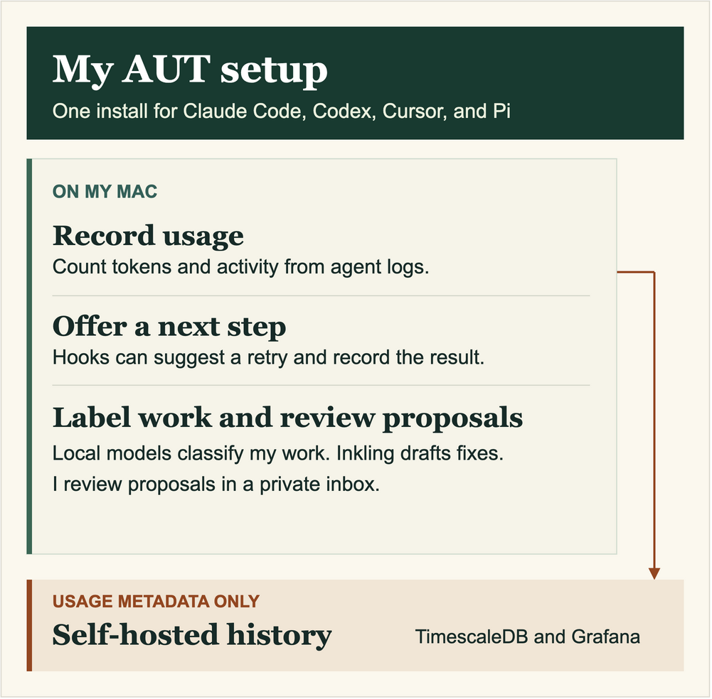

# How I run AUT

I run AUT on an Apple silicon Mac to track agent usage, classify work, and find recurring problems. AUT sends usage metadata to a self-hosted database. The local labeler combines that metadata with request and reply text on the Mac.

| Job | Models I use | Method |
| --- | --- | --- |
| What my message is doing | Elephant 1, PPLX Decider Flash, Kev 4B | Weighted scores |
| What kind of work I’m doing | PPLX Decider Flash, Elephant 1, Clef Flash | Majority vote |
| Where work with no code changes stands | Elephant 1, Kev 4B, Clef Flash | Weighted scores |
| Draft a fix for a recurring problem | Inkling 2 Mini via llama.cpp | Low reasoning effort, then human review |

The label recipes leave uncertain cases unknown. I run the larger Inkling model only when a recurring problem is eligible for a draft. Each proposal goes to a private inbox for review.

You can adapt this setup by starting with one [local decision model](local-labels.md#ongoing-local-estimates) per job and checking it against examples you’ve reviewed. Add [offline drafting](improvement.md#drafted-proposals) when you have a recurring problem worth testing a fix for.
